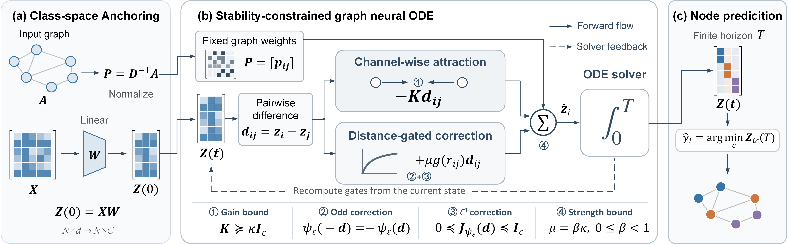

# Asymptotically Stable Graph Diffusion: Selective Smoothing at Matched Energy



Install the runtime dependencies from `requirements.txt` in a PyTorch/PyG
environment compatible with your CPU or CUDA installation.

## Main experiment

Run the experiment from this directory with:

```bash
python src/run_GNN.py
```

## Supplementary Experiment

### Propagation Dynamics under a Shared Physical-Time Grid


We compare full gating, ungated propagation, and spatially uniform gating on a shared physical-time grid, freezing the encoder, initial state, channel gains, graph, and readout within each checkpoint. Figure \ref{E4_shared} reports disagreement energy, test accuracy, normalized classification margin, and degree-weighted centroid drift over $t\in[0,8T_{\mathrm{ref}}]$. The three flows exhibit different energy-decay profiles, while their predictive differences depend on the dataset and propagation time. In particular, slower energy decay does not consistently imply better classification margins or accuracy. Centroid drift remains near numerical precision for all three flows, consistent with the conservation property of the symmetric graph dynamics. These frozen-checkpoint comparisons characterize propagation behavior and do not replace independently trained, time-tuned ablations.

### Hyperparameter Sensitivity

![Sensitivity to learning rate and weight decay over multiplicative scales from $0.1\times$ to $10\times$ their default values.][hyperparameter sensitivity.png]

To assess the robustness of ASGNODE to training hyperparameters, we vary the learning rate and weight decay from $0.1\times$ to $10\times$ their reference values on Cora and CiteSeer, keeping all other settings fixed. As shown in Figure~\ref{fig:sensitivity}, ASGNODE maintains competitive classification accuracy across a broad range of configurations. These results demonstrate empirical robustness to variations in the learning rate and weight decay under the evaluated settings.
